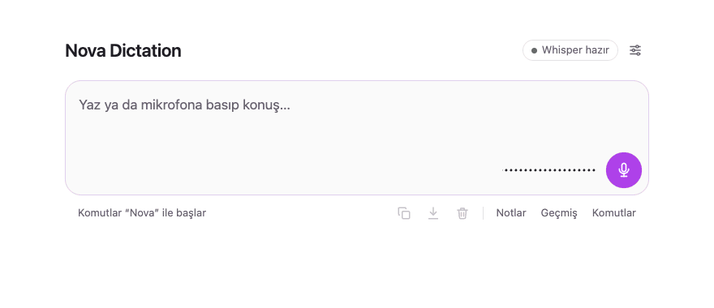
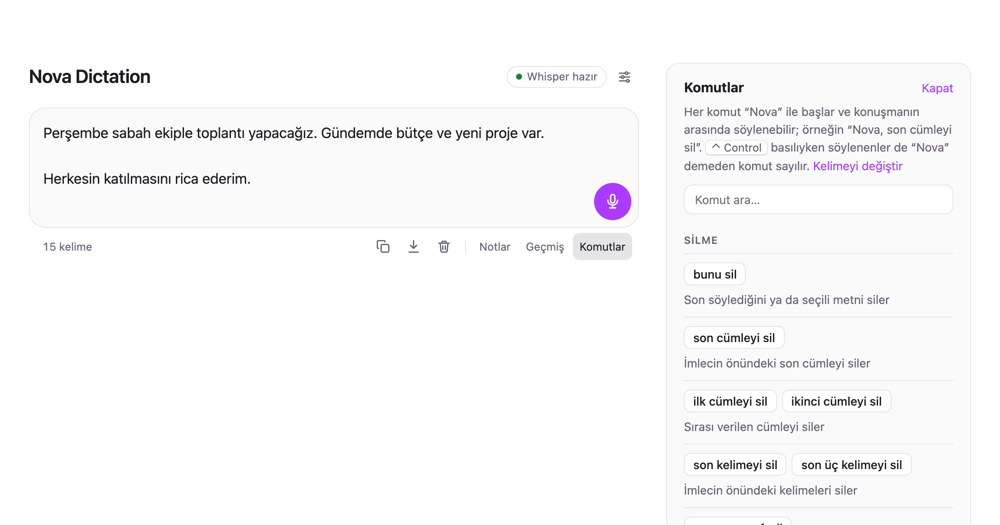

# Nova Dictation

[Türkçe](README.md) · **English**

[](https://github.com/mertkara256/nova-dictation/actions/workflows/ci.yml)

A Turkish dictation app that runs on your computer: you write by speaking and edit the text with voice commands said in the same breath.

While dictating, you can say “Nova, son cümleyi sil” (delete the last sentence), “Nova, yarın yerine perşembe yaz” (write “perşembe” instead of “yarın”) or “Nova, üç boş madde ekle” (add three empty bullets). The app separates the text to be written from the commands and applies the requested change; the command itself is not written into the text.



<sub>The microphone was fed macOS's Yelda voice. The label at the top shows what is being said; it is not part of the app.</sub>

The app is built for Turkish: dictation, voice commands and the interface are in Turkish.

> The project is under development. Dictation, voice commands and the editing tools work; commands that need AI (shortening, translation and their previews) are not there yet. See [Development status](#development-status) for details. “Nova” is a temporary working name.

## Highlights

- **Editing while you speak:** Commands are said in the middle of speaking; what is said before and after a command keeps being written. There are commands for deleting, correcting and formatting, moving, selecting, cutting and pasting, and undoing.
- **Live text:** While you speak, the text appears as a gray preview about once a second; when you pause, the final text with punctuation takes its place.
- **Commands without “Nova”:** While ⌃ Control is held down, what you say is not written into the text but applied as a command.
- **Audio stays on your computer:** Speech recognition runs on your computer with Whisper large-v3-turbo; it is free and needs no account.
- **Undo:** After each command, a note says what was done and offers a **Geri al** (Undo) button; “geri al” (undo) or “üç kere geri al” (undo three times) can also be said.
- **Notes:** Several notes can be kept, and they are stored in the browser as you write; the text can be downloaded as plain text or Markdown.
- **Personalization:** The command word can be changed, and frequently used names and terms are given to Whisper as a hint.

## Technically interesting parts

- **Command matching that knows Turkish suffixes:** Commands are defined in a small pattern language (`src/commands/grammar.ts`) and matched by counting letter differences, so speech recognition typos (“son cümle isi”, “No va”) are tolerated. Short phrases get a smaller error margin, and verbs spelled alike (“sil”, delete, and “seç”, select) never stand in for each other. The negative of a verb is not a command: “Nova, her şeyi silme” (don't delete everything) does not delete the text. Commands given with a word also find the word with a suffix attached: if the text only has “Raporu”, “rapor kelimesini seç” (select the word rapor) selects it.
- **End-to-end test with a fake microphone:** `npm run test:e2e` speaks Turkish sentences with macOS's Yelda voice and gives that audio to Chrome in place of a microphone. The microphone, speech detection, Whisper, voice commands and the ⌃ key are tried together in a real browser.
- **Speech scan with a synthetic voice:** `npm run scan:speech` has Whisper write 222 command and dictation cases spoken in the same voice (optionally also fast, slow and noisy). It passes Whisper's text through the app's editor, compares the result with the expected one and shows what newly broke compared with the saved results.
- **Decisions by measurement:** `npm run bench` measures delay and text errors on dictations recorded with a real voice. Changes that were measured and did not help (for example a larger model or beam search) are kept with their results in the [roadmap](YOL_HARITASI.md#denenip-elenenler) (in Turkish).
- **Tests:** More than 600 logic and UI tests run on GitHub on Linux and Windows for every change. The speech recognition services (Whisper and the browser's recognition) pass a shared contract test.

The measurement and test tools are described in detail in [docs/olcum-ve-test.en.md](docs/olcum-ve-test.en.md).

## Quick start

Requirements: Node.js 22.12 or later and Whisper running on your computer. Whisper is set up once; the steps are in [Whisper setup](#whisper-setup). It runs on macOS; Windows support has been added but not yet tried on a Windows computer.

```bash
npm install
npm start
```

`npm start` starts the Whisper server (if it is not already running) together with the development server and opens the app in the browser (http://localhost:5173). Closing the window or pressing Ctrl+C stops both. If the app is already running, it starts no second server and shows the open one. If another app is using port 5173, it does not start: the browser stores notes per address, so moving to another port would make the notes look lost. To put a one-click launcher on the desktop, run `npm run shortcut` once.

If Whisper is not installed, the app still opens and uses the browser's speech recognition (Web Speech). In this mode there is no Turkish punctuation, and the audio goes to Google or Apple (see [Speech recognition](docs/kullanim.en.md#speech-recognition)).

## Whisper setup

Whisper runs on your computer through [whisper.cpp](https://github.com/ggml-org/whisper.cpp) and is built from source. The program is expected in `~/Developer/whisper.cpp` and the models in `~/Developer/whisper-models` (`%USERPROFILE%\Developer\...` on Windows).

<details>
<summary>macOS (Apple silicon)</summary>

The Homebrew package has no server, so it is built from source:

```bash
brew install cmake
git clone --depth 1 --branch v1.9.5 https://github.com/ggml-org/whisper.cpp ~/Developer/whisper.cpp
cd ~/Developer/whisper.cpp
cmake -B build -DCMAKE_BUILD_TYPE=Release -DWHISPER_BUILD_SERVER=ON
cmake --build build -j --config Release --target whisper-server
```

Download the models (about 550 MB):

```bash
mkdir -p ~/Developer/whisper-models && cd ~/Developer/whisper-models
curl -LO https://huggingface.co/ggerganov/whisper.cpp/resolve/main/ggml-large-v3-turbo-q5_0.bin
curl -LO https://huggingface.co/ggml-org/whisper-vad/resolve/main/ggml-silero-v5.1.2.bin
```

</details>

<details>
<summary>Windows</summary>

> These steps have not been tried on a Windows computer yet. The tests and the build, however, run on Windows on GitHub for every change.

Install the required tools in PowerShell (the Visual Studio build tools take a while to install):

```powershell
winget install Git.Git
winget install Kitware.CMake
winget install OpenJS.NodeJS.LTS
winget install Microsoft.VisualStudio.2022.BuildTools --override "--wait --passive --add Microsoft.VisualStudio.Workload.VCTools --includeRecommended"
```

Open a new PowerShell window and build:

```powershell
git clone --depth 1 --branch v1.9.5 https://github.com/ggml-org/whisper.cpp "$HOME\Developer\whisper.cpp"
cd "$HOME\Developer\whisper.cpp"
cmake -B build -DWHISPER_BUILD_SERVER=ON
cmake --build build -j --config Release --target whisper-server
```

Download the models (about 550 MB):

```powershell
mkdir "$HOME\Developer\whisper-models"
cd "$HOME\Developer\whisper-models"
curl.exe -LO https://huggingface.co/ggerganov/whisper.cpp/resolve/main/ggml-large-v3-turbo-q5_0.bin
curl.exe -LO https://huggingface.co/ggml-org/whisper-vad/resolve/main/ggml-silero-v5.1.2.bin
```

With an NVIDIA graphics card, adding `-DGGML_CUDA=ON` to the first `cmake` command (the CUDA Toolkit must be installed) makes Whisper run much faster on the GPU. Without one, it runs on the CPU and the preview may lag; in that case a smaller model can be tried: download `ggml-small-q5_1.bin` from the same address and run `setx WHISPER_MODEL ggml-small-q5_1.bin`.

</details>

In the project folder, `npm start` starts Whisper and the app together. To start them separately, use `npm run whisper` and `npm run dev` in two terminals.

If the folders are different, they can be changed with the `WHISPER_DIR`, `WHISPER_MODELS_DIR` and `WHISPER_MODEL` environment variables; if the server program is somewhere else, give its full path with `WHISPER_SERVER`.

## Voice commands

Commands start with a command word; the default is “Nova”, and it can be changed in **Ayarlar** (Settings). They are said in the middle of speaking while the microphone is on, and the command itself is not written into the text. While **⌃ Control** is held, what you say is applied as a command without “Nova”. The **Komutlar** (Commands) button under the text opens the full list.



Commands are spoken in Turkish. Some examples, with their meaning:

| Group | Examples |
|---|---|
| Deleting | “bunu sil” (delete this: the last dictated part or the selection) · “son cümleyi sil” (the last sentence) · “ikinci cümleyi sil” (the second sentence) · “son üç kelimeyi sil” (the last three words) · “son paragrafı sil” (the last paragraph) · “son satırı sil” (the last line) · “yarın kelimesini sil” (the word “yarın”) · “her şeyi sil” (everything) |
| Correcting and formatting | “yarın yerine perşembe yaz” (write “perşembe” instead of “yarın”) · “yeni satır” (new line) · “yeni paragraf” (new paragraph) · “virgül” (comma) · “soru işareti” (question mark) · “tırnak aç” (open quote) · “parantez kapat” (close parenthesis) · “kısa çizgi” (hyphen) · “yarın kelimesini tırnak içine al” (put “yarın” in quotes) · “ankara kelimesini büyük harfle yaz” (capitalize “ankara”) · “bunu küçük harfle yaz” (lowercase this) · “üç boş madde ekle” (add three empty bullets) |
| Moving | “üçüncü satıra git” (go to the third line) · “ikinci paragrafa git” (go to the second paragraph) · “cümlenin başına git” (go to the start of the sentence) · “başa git” (go to the start) · “sona git” (go to the end) · “sonraki maddeye geç” (next bullet) · “toplantı kelimesinden sonra yaz” (write after the word “toplantı”) |
| Selecting | “son cümleyi seç” (the last sentence) · “ilk paragrafı seç” (the first paragraph) · “yarın kelimesini seç” (the word “yarın”) · “son üç kelimeyi seç” (the last three words) · “bunu seç” (this) · “her şeyi seç” (everything) · “yarın kelimesinden onda kelimesine kadar seç” (from “yarın” to “onda”) · “seçimi kaldır” (clear the selection) |
| General | “geri al” (undo) · “üç kere geri al” (undo three times) · “yinele” (redo) · “kopyala” (copy the selection, or all text if nothing is selected) · “metni kopyala” (copy all text) · “kes” (cut) · “son cümleyi kes” (cut the last sentence) · “yapıştır” (paste) · “son cümleyi başa taşı” (move the last sentence to the start) · “bunu sona taşı” (move this to the end) · “dinlemeyi durdur” (stop listening) · “duraklat” (pause) · “devam et” (resume) · “komutları göster” (show the commands) |

| Shortcut | What it does |
|---|---|
| ⌥ Space (Alt + M on Windows and Linux) | Turns the microphone on or off |
| Hold ⌃ Control (Ctrl on Windows and Linux) | Applies what you say while holding it as a command, without “Nova”; turns the microphone on for that time if it is off |
| Esc | Stops listening; if the microphone is off, closes the open panel |

The detailed command rules, the workspace (notes, draft saving, settings) and how speech recognition works are in [docs/kullanim.en.md](docs/kullanim.en.md).

## Development

For setup and running, see [Quick start](#quick-start).

| Command | What it does |
|---|---|
| `npm start` | Starts Whisper and the development server together and opens the app in the browser |
| `npm run shortcut` | Puts a launcher for the app on the desktop (`.command` on macOS, `.cmd` on Windows) |
| `npm run dev` | Starts only the development server |
| `npm run whisper` | Starts the local Whisper server (see [Whisper setup](#whisper-setup)) |
| `npm run bench` | Measures speech recognition speed and accuracy with audio recordings (while Whisper is running; see [Measurement recordings](docs/olcum-ve-test.en.md#measurement-recordings)) |
| `npm test` | Runs the tests once |
| `npm run test:watch` | Runs the tests and reruns them on changes |
| `npm run test:e2e` | Tries the whole app in real Chrome as if someone were speaking into the microphone (on macOS, while Whisper is running; see [End-to-end test](docs/olcum-ve-test.en.md#end-to-end-test)) |
| `npm run scan:speech` | Has Whisper write commands and dictated sentences spoken in the Yelda voice and checks that the app reaches the right result (on macOS, while Whisper is running; see [Speech scan](docs/olcum-ve-test.en.md#speech-scan)) |
| `npm run lint` | Lints the code with Oxlint |
| `npm run typecheck` | Runs the TypeScript type check |
| `npm run build` | Builds the production version into `dist/` |

Code layout:

- `src/core`: The document (text and caret), text operations, applying commands and the undo history; plain TypeScript, independent of the UI.
- `src/commands`: The patterns that split spoken text into commands and text, and the typo-tolerant matching.
- `src/speech`: Speech recognition. The UI only knows the `Transcriber` contract; services live under `providers/`, and `index.ts` decides which one is used.
- `src/ui`: React components.
- `scripts`: The script that starts the Whisper server, the measurement tool, the end-to-end test, the speech scan, and the development server plugin that writes measurement recordings to disk.
- Tests: `*.test.ts` files are logic tests and run directly in Node. `*.test.tsx` files are UI tests; they render components in a simulated browser page (jsdom) and click and type like a user. Shared test helpers live in `src/test`.

To add a new command, add a pattern to `src/commands/grammar.ts`, its implementation to `src/core/apply.ts` and its description to `src/commands/help.ts`.

To change the speech recognition service, create a `.env.local` file in the project folder:

```bash
VITE_STT_PROVIDER=webspeech   # or whisper
```

To add a new service, write a file under `src/speech/providers/` and select it in `src/speech/index.ts`. Every service has to pass the shared contract tests in `describeTranscriberContract`.

## Development status

Turkish dictation works: while you speak, the text updates as a gray preview about once a second, and when you pause, the final text with punctuation settles in (both from Whisper). Deleting, correcting, moving, selecting and general voice commands work with “Nova” or while ⌃ Control is held; the command word can be changed in Settings. Several notes can be kept and are saved automatically; the text can be downloaded and the command history can be viewed. Speed and accuracy can be measured with recorded real dictations (`npm run bench`), and the app can be tried end to end with real Chrome and Whisper (`npm run test:e2e`). It runs on macOS; Windows support has been added but not yet tried on a Windows computer. Commands that need AI (shortening, translation) are not there yet. Upcoming work and later ideas are in [YOL_HARITASI.md](YOL_HARITASI.md) (roadmap, in Turkish).

Known limitations:

- The preview and the final text use the same Whisper server, so if a preview request is being processed, the final text can be delayed by up to about a second.
- After switching to the browser's speech recognition, the text arrives without punctuation, so “son cümleyi sil” (delete the last sentence) cannot find sentence boundaries.
- When giving commands with ⌃, command mode starts once the key has been held for a quarter of a second; if you start speaking the moment you press the key during dictation, the first syllable may slip into the text.
