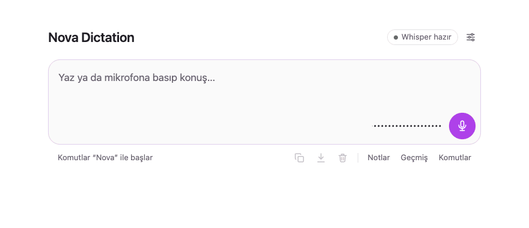
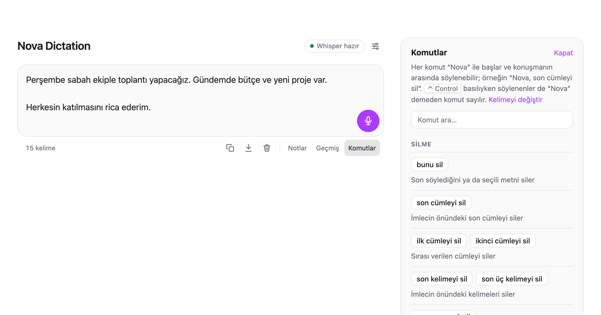

# Nova Dictation

**Türkçe** · [English](README.en.md)

[](https://github.com/mertkara256/nova-dictation/actions/workflows/ci.yml)

Konuşarak yazmayı ve aynı konuşmanın içinde verilen sesli komutlarla metni düzenlemeyi sağlayan, bilgisayarda çalışan bir Türkçe dikte uygulaması.

Dikte ederken “Nova, son cümleyi sil”, “Nova, yarın yerine perşembe yaz” ya da “Nova, üç boş madde ekle” denebilir. Uygulama yazılacak metinle komutları ayırır ve istenen değişikliği metne uygular; komutun kendisi metne yazılmaz.



<sub>Mikrofon yerine macOS'un Yelda sesi verildi. Üstteki etiket o an söyleneni gösterir; uygulamanın parçası değildir.</sub>

**Kurmadan dene:** [Deneme sürümü](https://mertkara256.github.io/nova-dictation/) tarayıcıda açılır (Chrome ya da Safari). Orada konuşmayı tarayıcının kendi tanıması yazıya çevirir ve ses Google'a ya da Apple'a gider. Bu tanıma noktalama koymadığı için her duraklamada cümle biter ve ⌃ ile komut verilemez.

> Proje geliştirme aşamasındadır. Dikte, sesli komutlar ve düzenleme araçları çalışıyor; yapay zekâ gerektiren komutlar (kısaltma, çeviri ve önizlemeleri) henüz yok. Ayrıntılar için [Geliştirme durumu](#geliştirme-durumu) bölümüne bakın.

## Öne çıkan özellikler

- **Konuşurken düzenleme:** Komutlar konuşmanın arasında söylenir; komuttan önce ve sonra söylenenler yazılmaya devam eder. Silme, düzeltme ve biçim, gezinme, seçme, kesip yapıştırma ve geri alma komutları var.
- **Canlı metin:** Konuşurken metin yaklaşık saniyede bir gri önizleme olarak görünür; duraklayınca noktalamalı kesin metin onun yerine geçer.
- **“Nova” demeden komut:** ⌃ Control basılı tutulurken söylenenler metne yazılmaz, komut olarak uygulanır.
- **Ses bilgisayarda kalır:** Konuşma tanıma, bilgisayarda çalışan Whisper large-v3-turbo ile yapılır; ücretsizdir ve hesap gerektirmez.
- **Geri alma:** Her komuttan sonra ne yapıldığı ve bir **Geri al** düğmesi görünür; “geri al” ya da “üç kere geri al” sesle de söylenebilir.
- **Notlar:** Birden fazla not tutulur ve yazıldıkça tarayıcıda saklanır; metin düz metin ya da Markdown olarak indirilebilir.
- **Kişiselleştirme:** Komut kelimesi değiştirilebilir; sık kullanılan isim ve terimler Whisper'a ipucu olarak verilir.

## Teknik açıdan ilginç noktalar

- **Türkçe ekleri bilen komut eşleştirme:** Komutlar küçük bir kalıp dilinde tanımlanır (`src/commands/grammar.ts`) ve harf farkı sayılarak eşleştirilir; böylece konuşma tanımanın yazım hataları (“son cümle isi”, “No va”) tolere edilir. Kısa ifadelerde hata payı düşük tutulur, yazımı birbirine yakın fiiller (“sil”, “seç”) birbirinin yerine geçmez. Fiilin olumsuzu komut sayılmaz: “Nova, her şeyi silme” metni silmez. Kelimeyle verilen komutlar kelimenin ekli halini de bulur: metinde yalnızca “Raporu” varsa “rapor kelimesini seç” onu seçer.
- **Sahte mikrofonla uçtan uca test:** `npm run test:e2e` Türkçe cümleleri macOS'un Yelda sesiyle seslendirir ve Chrome'a mikrofon yerine bu sesi verir. Mikrofon, konuşma algılama, Whisper, sesli komutlar ve ⌃ tuşu gerçek bir tarayıcıda birlikte denenir.
- **Sentetik sesle ses taraması:** `npm run scan:speech` 222 komut ve dikte vakasını aynı sesle (isteğe göre hızlı, yavaş ve gürültülü çeşitleriyle) Whisper'a okutur. Whisper'ın yazdığını uygulamanın düzenleyicisinden geçirip beklenen sonuçla karşılaştırır ve kayıtlı sonuçlara göre yeni bozulanları gösterir.
- **Ölçerek karar verme:** `npm run bench` gerçek sesle kaydedilmiş diktelerde gecikmeyi ve metin hatasını ölçer. Ölçülüp işe yaramadığı görülen değişiklikler (ör. daha büyük bir model, ışın araması) sonuçlarıyla birlikte [yol haritasında](YOL_HARITASI.md#denenip-elenenler) durur.
- **Testler:** 600'den fazla mantık ve arayüz testi her değişiklikte GitHub'da Linux ve Windows'ta çalışır. Konuşma tanıma servisleri (Whisper ve tarayıcının tanıması) ortak bir sözleşme testinden geçer.

Ölçüm ve test araçlarının ayrıntıları [docs/olcum-ve-test.md](docs/olcum-ve-test.md) dosyasındadır.

## Hızlı başlangıç

Gerekenler: Node.js 22.12 veya üstü ve bilgisayarda çalışan Whisper. Whisper bir kez kurulur; adımlar [Whisper kurulumu](#whisper-kurulumu) bölümündedir. macOS'ta çalışır; Windows desteği eklendi ama henüz bir Windows bilgisayarda denenmedi.

```bash
npm install
npm start
```

`npm start` Whisper sunucusunu (çalışmıyorsa) ve geliştirme sunucusunu birlikte başlatır, uygulamayı tarayıcıda açar (http://localhost:5173). Pencere kapanınca ya da Ctrl+C'ye basılınca ikisi de kapanır. Uygulama zaten açıksa yeni bir sunucu başlatmaz, açık olanı gösterir. 5173 portunu başka bir uygulama kullanıyorsa başlamaz: notlar tarayıcıda bu adrese bağlı saklandığı için başka bir porta geçmek notları kaybolmuş gibi gösterirdi. Masaüstüne tek tıkla açan bir kısayol koymak için bir kez `npm run shortcut` çalıştırın.

Whisper kurulu değilse ya da çalışmıyorsa uygulama yine açılır, ama mikrofona basınca Whisper'ın nasıl başlatılacağını gösterir ve kendiliğinden başka bir tanımaya geçmez. İstenirse **Tarayıcının tanımasıyla devam et** ile tarayıcının konuşma tanıması (Web Speech) kullanılabilir; o zaman ses Google'a ya da Apple'a gider ve Türkçe noktalama olmadığı için her duraklama cümle sonu sayılır. Bu izin sayfa açık kaldığı sürece geçerlidir, kaydedilmez (bkz. [Konuşma tanıma](docs/kullanim.md#konuşma-tanıma)).

## Whisper kurulumu

Whisper, [whisper.cpp](https://github.com/ggml-org/whisper.cpp) ile bilgisayarda çalışır ve kaynak kodundan derlenir. Program `~/Developer/whisper.cpp`, modeller `~/Developer/whisper-models` klasöründe beklenir (Windows'ta `%USERPROFILE%\Developer\...`).

<details>
<summary>macOS (Apple çipli)</summary>

Homebrew paketinde sunucu bulunmadığı için kaynak kodundan derlenir:

```bash
brew install cmake
git clone --depth 1 --branch v1.9.5 https://github.com/ggml-org/whisper.cpp ~/Developer/whisper.cpp
cd ~/Developer/whisper.cpp
cmake -B build -DCMAKE_BUILD_TYPE=Release -DWHISPER_BUILD_SERVER=ON
cmake --build build -j --config Release --target whisper-server
```

Modelleri indirin (yaklaşık 550 MB):

```bash
mkdir -p ~/Developer/whisper-models && cd ~/Developer/whisper-models
curl -LO https://huggingface.co/ggerganov/whisper.cpp/resolve/main/ggml-large-v3-turbo-q5_0.bin
curl -LO https://huggingface.co/ggml-org/whisper-vad/resolve/main/ggml-silero-v5.1.2.bin
```

</details>

<details>
<summary>Windows</summary>

> Bu adımlar henüz bir Windows bilgisayarda denenmedi. Testler ve derleme ise her değişiklikte GitHub'da Windows'ta da çalıştırılıyor.

Gerekli araçları PowerShell'de kurun (Visual Studio derleme araçlarının kurulumu biraz sürer):

```powershell
winget install Git.Git
winget install Kitware.CMake
winget install OpenJS.NodeJS.LTS
winget install Microsoft.VisualStudio.2022.BuildTools --override "--wait --passive --add Microsoft.VisualStudio.Workload.VCTools --includeRecommended"
```

Yeni bir PowerShell penceresi açıp derleyin:

```powershell
git clone --depth 1 --branch v1.9.5 https://github.com/ggml-org/whisper.cpp "$HOME\Developer\whisper.cpp"
cd "$HOME\Developer\whisper.cpp"
cmake -B build -DWHISPER_BUILD_SERVER=ON
cmake --build build -j --config Release --target whisper-server
```

Modelleri indirin (yaklaşık 550 MB):

```powershell
mkdir "$HOME\Developer\whisper-models"
cd "$HOME\Developer\whisper-models"
curl.exe -LO https://huggingface.co/ggerganov/whisper.cpp/resolve/main/ggml-large-v3-turbo-q5_0.bin
curl.exe -LO https://huggingface.co/ggml-org/whisper-vad/resolve/main/ggml-silero-v5.1.2.bin
```

NVIDIA ekran kartı varsa ilk `cmake` komutuna `-DGGML_CUDA=ON` eklenerek (CUDA Toolkit kurulu olmalı) Whisper ekran kartında çok daha hızlı çalışır. Ekran kartı olmadan işlemcide çalışır ve önizleme gecikebilir; o zaman daha küçük bir model denenebilir: `ggml-small-q5_1.bin` dosyasını aynı adresten indirip `setx WHISPER_MODEL ggml-small-q5_1.bin` komutunu çalıştırın.

</details>

Proje klasöründe `npm start` Whisper'ı ve uygulamayı birlikte başlatır. Ayrı ayrı başlatmak için iki terminalde `npm run whisper` ve `npm run dev` kullanılabilir. Whisper her başlatılışta rastgele bir adresle açılır ve bu adresi yalnızca uygulama bilir; böylece tarayıcıda açık başka siteler Whisper'a ulaşamaz.

Klasörler farklıysa `WHISPER_DIR`, `WHISPER_MODELS_DIR` ve `WHISPER_MODEL` ortam değişkenleriyle değiştirilebilir; sunucu programı başka bir yerdeyse tam yolu `WHISPER_SERVER` ile verilir.

## Sesli komutlar

Komutlar bir komut kelimesiyle başlar; varsayılan kelime “Nova”dır ve **Ayarlar**'dan değiştirilebilir. Mikrofon açıkken konuşmanın arasında söylenir ve komutun kendisi metne yazılmaz. **⌃ Control** basılı tutulurken söylenenler “Nova” demeden komut olarak uygulanır. Metnin altındaki **Komutlar** düğmesi tam listeyi açar.



| Grup | Örnekler |
|---|---|
| Silme | “bunu sil” (son söylenen ya da seçili metin) · “son cümleyi sil” · “ikinci cümleyi sil” · “son üç kelimeyi sil” · “son paragrafı sil” · “son satırı sil” · “yarın kelimesini sil” · “her şeyi sil” |
| Düzeltme ve biçim | “yarın yerine perşembe yaz” · “yeni satır” · “yeni paragraf” · “virgül” · “soru işareti” · “tırnak aç” · “parantez kapat” · “kısa çizgi” · “yarın kelimesini tırnak içine al” · “ankara kelimesini büyük harfle yaz” · “bunu küçük harfle yaz” · “üç boş madde ekle” |
| Gezinme | “üçüncü satıra git” · “ikinci paragrafa git” · “cümlenin başına git” · “başa git” · “sona git” · “sonraki maddeye geç” · “toplantı kelimesinden sonra yaz” |
| Seçme | “son cümleyi seç” · “ilk paragrafı seç” · “yarın kelimesini seç” · “son üç kelimeyi seç” · “bunu seç” · “her şeyi seç” · “yarın kelimesinden onda kelimesine kadar seç” · “seçimi kaldır” |
| Genel | “geri al” · “üç kere geri al” · “yinele” · “kopyala” (seçili metin ya da bütün metin) · “metni kopyala” · “kes” · “son cümleyi kes” · “yapıştır” · “son cümleyi başa taşı” · “bunu sona taşı” · “dinlemeyi durdur” · “duraklat” · “devam et” · “komutları göster” |

| Kısayol | İşlev |
|---|---|
| ⌥ Boşluk (Windows ve Linux'ta Alt + M) | Mikrofonu açar ya da kapatır |
| ⌃ Control basılı (Windows ve Linux'ta Ctrl) | Basılıyken söylenenleri “Nova” demeden komut olarak uygular; mikrofon kapalıysa o süre için açar |
| Esc | Dinlemeyi durdurur; mikrofon kapalıysa açık paneli kapatır |

Komutların ayrıntılı kuralları, çalışma alanı (notlar, taslak kaydı, ayarlar) ve konuşma tanımanın nasıl çalıştığı [docs/kullanim.md](docs/kullanim.md) dosyasındadır.

## Geliştirme

Kurulum ve çalıştırma için bkz. [Hızlı başlangıç](#hızlı-başlangıç).

| Komut | Açıklama |
|---|---|
| `npm start` | Whisper'ı ve geliştirme sunucusunu birlikte başlatır, uygulamayı tarayıcıda açar |
| `npm run shortcut` | Masaüstüne uygulamayı başlatan bir kısayol koyar (macOS'ta `.command`, Windows'ta `.cmd`) |
| `npm run dev` | Yalnızca geliştirme sunucusunu başlatır |
| `npm run whisper` | Yerel Whisper sunucusunu başlatır (bkz. [Whisper kurulumu](#whisper-kurulumu)) |
| `npm run bench` | Konuşma tanımanın hızını ve doğruluğunu ses kayıtlarıyla ölçer (Whisper açıkken; bkz. [Ölçüm kayıtları](docs/olcum-ve-test.md#ölçüm-kayıtları)) |
| `npm test` | Testleri bir kez çalıştırır |
| `npm run test:watch` | Testleri, değişiklikleri izleyerek çalıştırır |
| `npm run test:e2e` | Uygulamayı gerçek Chrome'da, mikrofona konuşuluyormuş gibi baştan sona dener (macOS'ta, Whisper açıkken; bkz. [Uçtan uca test](docs/olcum-ve-test.md#uçtan-uca-test)) |
| `npm run scan:speech` | Komutları ve dikte cümlelerini Yelda sesiyle Whisper'a okutup uygulamanın doğru sonuca varıp varmadığını denetler (macOS'ta, Whisper açıkken; bkz. [Ses taraması](docs/olcum-ve-test.md#ses-taraması)) |
| `npm run lint` | Oxlint ile kod denetimi yapar |
| `npm run typecheck` | TypeScript tip denetimi yapar |
| `npm run build` | Yayına hazır sürümü `dist/` klasörüne üretir |
| `npm run build:demo` | Whisper'sız, tarayıcının konuşma tanımasıyla çalışan deneme sürümünü `dist/` klasörüne üretir; GitHub Pages'teki deneme sürümü bununla derlenir |

Kod yapısı:

- `src/core`: Belge (metin ve imleç), metin işlemleri, komutların uygulanması ve geri alma geçmişi; arayüzden bağımsız, saf TypeScript.
- `src/commands`: Konuşulan metni komut ve metin parçalarına ayıran kalıplar ve hataya toleranslı eşleştirme.
- `src/speech`: Konuşma tanıma. Arayüz yalnızca `Transcriber` sözleşmesini bilir; servisler `providers/` altındadır, hangisinin kullanılacağına `index.ts` karar verir.
- `src/ui`: React bileşenleri.
- `scripts`: Whisper sunucusunu başlatan betik, ölçüm aracı, uçtan uca test, ses taraması ve ölçüm kayıtlarını diske yazan geliştirme sunucusu eklentisi.
- Testler: `*.test.ts` dosyaları mantık testleridir ve doğrudan Node'da çalışır. `*.test.tsx` dosyaları arayüz testleridir; bileşenleri sahte bir tarayıcı sayfasında (jsdom) çizip kullanıcı gibi tıklar ve yazar. Ortak test yardımcıları `src/test` altındadır.

Yeni bir komut eklemek için `src/commands/grammar.ts` dosyasına bir kalıp, `src/core/apply.ts` dosyasına uygulaması ve `src/commands/help.ts` dosyasına açıklaması eklenir.

Konuşma tanıma servisini değiştirmek için proje klasöründe bir `.env.local` dosyası oluşturun:

```bash
VITE_STT_PROVIDER=webspeech   # veya whisper
```

Yeni bir servis eklemek için `src/speech/providers/` altına bir dosya yazmak ve onu `src/speech/index.ts` içinde seçmek yeterlidir. Her servis, `describeTranscriberContract` ile ortak sözleşme testlerinden geçer.

## Geliştirme durumu

Türkçe dikte çalışıyor: konuşurken metin yaklaşık saniyede bir gri önizleme olarak güncelleniyor, duraklayınca noktalamalı kesin metin yerleşiyor (ikisi de Whisper). Silme, düzeltme, gezinme, seçme ve genel sesli komutlar “Nova” ile ya da ⌃ Control basılıyken çalışıyor; komut kelimesi Ayarlar'dan değiştirilebiliyor. İlk kullanım rehberinde mikrofon ve örnek komutlar söylenerek denenebiliyor. Birden fazla not tutulabiliyor ve notlar otomatik kaydediliyor; metin indirilebiliyor ve komut geçmişi görülebiliyor. Hız ve doğruluk, kaydedilen gerçek diktelerle ölçülebiliyor (`npm run bench`); uygulama gerçek Chrome ve Whisper'la uçtan uca da denenebiliyor (`npm run test:e2e`). macOS'ta çalışıyor; Windows desteği eklendi ama henüz bir Windows bilgisayarda denenmedi. Yapay zekâ gerektiren komutlar (kısaltma, çeviri) henüz yok. Sıradaki işler ve ileride düşünülen fikirler [YOL_HARITASI.md](YOL_HARITASI.md) dosyasındadır.

Bilinen sınırlar:

- Önizleme ve kesin metin aynı Whisper sunucusunu kullandığı için, o an bir önizleme isteği işleniyorsa kesin metin en fazla bir saniye kadar gecikebilir.
- Tarayıcının konuşma tanımasında noktalama olmadığı için her duraklama cümle sonu sayılır; cümlenin ortasında duraklanırsa araya yanlış bir nokta girer.
- ⌃ ile komut verirken komut modu tuş çeyrek saniye basılı kalınca başlar; dikte sürerken tuşa basar basmaz konuşulursa ilk hece metne kaçabilir.
- Whisper, “Nova” ile başlayan komutlarda “Nova”yı ara sıra yazmıyor (ölçümde yaklaşık 40 komutta bir); o zaman komut metne yazılır. ⌃ basılıyken verilen komutlarda “Nova” gerekmediği için bu olmaz.
